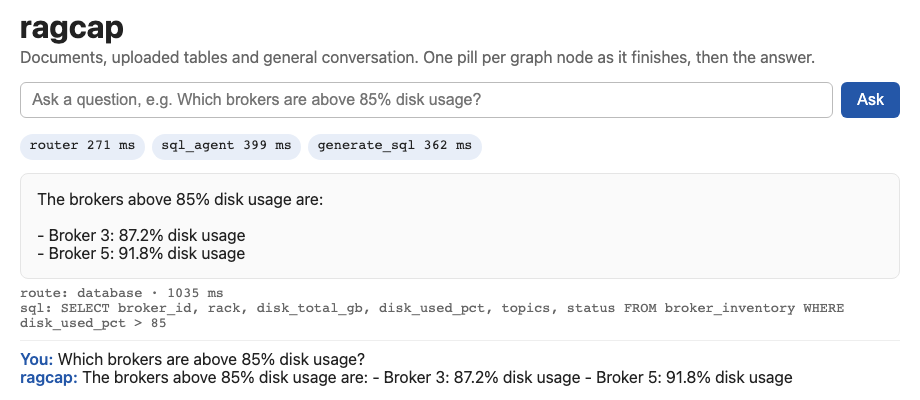
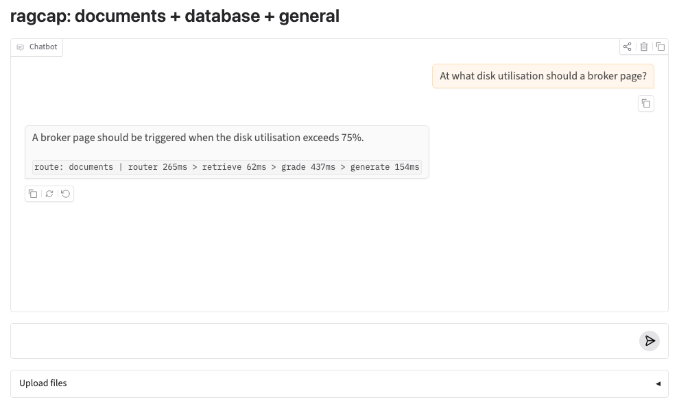

# ragcap

Live showcase (static, recorded runs): https://shreenathacc22.github.io/ragcap/  ·  Vercel: `vercel.json` serves `site/` (deployment steps on slide 13 of the deck).

A reproduction of Kumar's RAG Capstone design (LangGraph router, document RAG with grade/rewrite, SQL agent, general agent, Postgres + pgvector, FastAPI, Gradio) on local models, plus a frozen evaluation set with quality metrics and a version-aware retrieval filter.

- Install by hand on a Mac (what to download, where from, each step, daily use): [docs/INSTALL_AND_USE.md](docs/INSTALL_AND_USE.md) (PDF: `docs/INSTALL_ragcap.pdf`)
- Rebuild from zero and run every scenario: [docs/RECREATE.md](docs/RECREATE.md) (PDF: `docs/RECREATE_ragcap.pdf`); one command: `./recreate.sh`
- SOP, pre-work to troubleshooting, with commands and results measured on an Apple M5 Pro: `docs/SOP_ragcap_build.pdf`
- Operating and troubleshooting: `docs/RUNBOOK_ragcap_operations.pdf`
- Slide deck (15 slides: flow, steps, results, how to test, how to deploy to Vercel): `docs/ragcap_deck.pptx` (PDF: `docs/ragcap_deck.pdf`; source `docs/build_deck.js`)
- Project status (done and pending): [STATUS.md](STATUS.md)
- Running on an Apple Silicon Mac, and which models to keep: [docs/APPLE_SILICON.md](docs/APPLE_SILICON.md)
- Start / check after a reboot: `./services.sh start && ./services.sh check` (ends `CLEAN START OK`).
- Needs: Ollama (`llama3.2:3b`, `nomic-embed-text`) and Python 3.12. Postgres + pgvector run natively through `pgctl.sh` from the pip wheel `pgserver` (it uses Docker instead if installed). No API key, no admin rights.
- Results on an Apple M5 Pro (llama3.2:3b, 3 runs each, identical): router 100% on both test sets; answers 92.6% on the tuned set and 80% on the unseen set (96% with the qwen3:8b second-opinion grader); version filter: superseded chunks 51.6% to 0.0%, control cases flat, at most 1 ms; about 1 s per document question. Scenario catalogue (`scenarios.py`): 12 pass, 5 known weaknesses, 0 unexpected.
- Models: required `llama3.2:3b` + `nomic-embed-text` (~2.7 GB memory); recommended `qwen3:8b` as second-opinion grader; `qwen2.5vl:3b` only for drawings. What each costs and what to remove: [docs/APPLE_SILICON.md](docs/APPLE_SILICON.md) section 7.

- Interfaces: a static page on the streaming API (`web/`, served at `/`) and a Gradio chat (`ui.py`). Optional LangSmith tracing (`LANGSMITH_TRACING=true`).
- P&ID branch: synthetic drawings with ground truth (`pid/`), vision-model descriptions into the same index, measured in `results/pid_eval_summary.md`.

Secrets: `.env` holds the database password and is gitignored. Never commit it.
